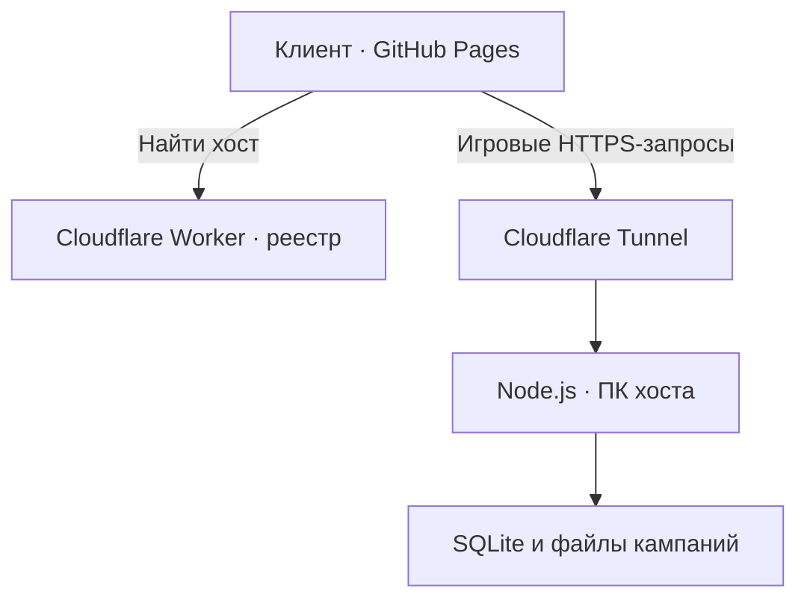

# DungeonTable — техническое задание

Версия: 0.1 · редакция 2, подключение по архитектуре Table · 22 ноября 2026 · статус: проект для обсуждения и утверждения.

## 1. Назначение

DungeonTable — общий двумерный стол для проведения D&D в компании друзей. Мастер заранее готовит кампанию, сцены, персонажей и предметы. Во время игры участники перемещают токены, бросают кости, используют способности и взаимодействуют с объектами. Система хранит состояние партии и объясняет каждый автоматический расчёт.

Продукт должен позволять провести целую игровую сессию, не переключаясь между картой, таблицей инвентаря и калькулятором. Голосовая связь на первом этапе остаётся в привычном приложении участников.

Это 2D-стол сверху: фон сцены, сетка, токены, изображения предметов, области и измерители. Физики, свободной 3D-камеры и обязательных анимаций кубиков нет.

Сайт публикуется на GitHub Pages. В корне публикации находится `index.html`; пути работают и по адресу `/<имя-репозитория>/`. Sites не используется.

## 2. Требования и предварительные решения

| Статус | Решение |
|---|---|
| Требование пользователя | Совместный стол, подготовленные сцены, персонажи, инвентарь, развитие, создание объектов из изображений |
| Требование пользователя | Перед началом боя мастер явно назначает стороны; назначение не зависит от типа NPC |
| Требование пользователя | Автоматические броски с видимыми костями, формулами и баффами |
| Требование пользователя | Чистый интерфейс при богатой функциональности |
| Предложение | Русский интерфейс, тёмная тема по умолчанию, управление мышью и клавиатурой |
| Уточнение пользователя | Первый набор правил — D&D 5e 2024 / SRD 5.2.1 |
| Уточнение пользователя | Пользователь запускает сервер на своём ПК, создаёт комнату; затем входит браузером как ГМ, друзья — как игроки |
| Предложение | Первая целевая группа — мастер и до 6 игроков; несколько персонажей на одного участника допустимы |

Редакция и схема подключения выбраны пользователем: D&D 2024, клиент GitHub Pages, реестр Cloudflare Worker, Cloudflare Tunnel и Node.js на ПК хоста. Ориентир: https://verydeepwell.github.io/Table/#/ . Описание подключения предоставлено пользователем; локально сверены ключевые участки реестра, запускателя и поиска сервера. Существующий Table не изменяется. API ниже — требования DungeonTable, а не утверждение о полной совместимости с API Table.

## 3. Главные сценарии

### 3.1. Подготовка приключения

1. Мастер создаёт кампанию и выбирает набор правил.
2. Загружает изображение карты, задаёт масштаб сетки по двум точкам, выбирает единицы расстояния.
3. Размещает героев, NPC, предметы и скрытые объекты. Может взять экземпляр из библиотеки или создать новый.
4. Настраивает владельцев персонажей, видимость, начальные состояния и содержимое контейнеров.
5. Готовит следующие сцены, заметки и раздаточные материалы.
6. Сохраняет кампанию и открывает сеанс. Игроки входят, мастер допускает каждого и назначает персонажей.

### 3.2. Свободная игра

Игрок выбирает токен и видит доступные действия своего героя. Перетаскивание меняет позицию по разрешению режима перемещения. Предмет можно достать из инвентаря на стол, передать другому персонажу или подобрать. У остальных обновляются позиция, доступное содержимое и журнал. Для спорного взаимодействия мастер назначает проверку; система сама подставляет модификаторы и бросает кости.

### 3.3. Начало боя с неожиданным союзником

Стражник первоначально подготовлен как противник, но игроки его убедили. Мастер нажимает «В бой», включает нужные токены, назначает стражника союзником, разбойников — противниками, торговца — нейтральным наблюдателем. До подтверждения броски не выполняются. После подтверждения инициатива бросается один раз для каждого включённого бойца.

### 3.4. Прозрачная атака

Игрок выбирает оружие и цель. Система показывает дальность, расход и применимые эффекты; после запуска действия бросает атаку. При попадании выполняет предусмотренные броски урона. Журнал раскрывает кости, источники модификаторов, попадание, критический урон, сопротивление и итоговое изменение HP. Неописанное в правилах обстоятельство решает мастер.

### 3.5. Возвращение к игре

После разрыва связи игрок переподключается под прежним участником, мастер подтверждает восстановление доступа. Загружается актуальное разрешённое состояние, затем новые события. Повторная доставка команды не создаёт второй бросок, второй предмет или второй расход ресурса.

## 4. Роли, управление и видимость

| Действие | Мастер | Владелец персонажа | Другой игрок |
|---|---|---|---|
| Редактировать сцену, скрывать объекты | Да | Нет | Нет |
| Перемещать токен | Любой | Свой, по режиму | Только при выданном доступе |
| Редактировать лист | Любой | Свой, с журналом изменений | Нет |
| Использовать предмет/способность | Любой | Свой | Нет |
| Назначить проверку и сложность | Да | Запросить/кинуть свободную | Запросить/кинуть свободную |
| Менять стороны, очередь и раунд | Да | Нет | Нет |
| Смотреть секреты сцены | Да | Только раскрытое | Только раскрытое |
| Экспортировать полную кампанию | Да | Только свой лист и доступные данные | Только доступные данные |

Контроль токена, принадлежность к стороне и видимость — независимые свойства. Союзный NPC может оставаться под управлением мастера; персонаж игрока может временно оказаться в другой стороне без потери владельца.

Скрытые объекты, содержимое закрытых контейнеров, заметки мастера и закрытые характеристики NPC не отправляются игрокам. Скрытие только средствами CSS не считается реализацией приватности. Режим «глазами игрока» помогает мастеру проверить раскрытие; отдельные тесты проверяют сетевые данные и экспорт.

Мастер может открыть игрокам точные HP/КД NPC или только состояния «невредим / ранен / при смерти». В публичном броске против закрытой КД видны собственные модификаторы и результат попадания, но секретное значение не раскрывается. Каждое ограничение явно обозначается.

## 5. Общий стол и сцены

### 5.1. Представление

- Панорамирование, масштабирование к указателю, кнопка «Вписать сцену», независимая камера каждого участника.
- Квадратная сетка, настройка размера и смещения, режим без сетки. Гексагональная сетка — последующее расширение.
- Слои: карта, декорации, интерактивные объекты, токены, эффекты/области, заметки мастера.
- Выделение, групповое перемещение мастером, блокировка фона, порядок наложения, поворот и масштаб объектов.
- Линейка, путь по клеткам, пинг, временный рисунок. Сетка не определяет реальный размер картинки: масштаб задаёт мастер.
- Прямоугольник, круг, конус и линия как шаблоны областей. Попадание в пограничную клетку зависит от настроенного правила и может быть исправлено мастером.
- Индикатор владельца, HP и состояний токена; сторона обозначается цветом и подписью/значком, не одним цветом.

### 5.2. Перемещение

В свободном режиме игрок двигает своего персонажа без очереди. В тактическом режиме перемещение учитывает скорость, трудную местность и израсходованное расстояние. Доступен режим «запросить перемещение»: мастер подтверждает конечную позицию.

Путь задаётся точками; первая версия не обещает поиск пути вокруг стен. Перед фиксацией видны длина и остаток движения. Правило диагоналей выбирается в кампании. Возврат незафиксированного пути бесплатный; отмена уже совершённого движения оформляется событием мастера.

Препятствия в первой версии — аннотации и решение мастера. Автоматическая геометрия стен, дверей и видимости относится к последующему этапу. Измерение дистанции поддерживает дистанцию между границами занимаемых клеток, включая больших существ.

### 5.3. Подготовка и переключение сцен

Кампания содержит список сцен, миниатюры, заметки, группы объектов и точки входа. Редактирование неактивной сцены не переключает игроков. При переходе переносится ссылка на того же персонажа с текущими HP, эффектами и инвентарём; токен — представление персонажа, а не независимый лист.

Перед публикацией следующей сцены мастер проверяет предпросмотр. Новым участникам передаются только разрешённые объекты текущей сцены. Камера игроков меняется принудительно только по явному действию «Показать место».

### 5.4. Скрытие карты

Первый вариант — ручное раскрытие подготовленных комнат/участков мастером. Для действительно закрытых участков передаётся только раскрытая графика: полный исходник карты со спойлерами не должен заранее попадать на клиент игрока. Один общий фон допустим только для карты, которую можно целиком видеть. Динамический свет, зрение каждого токена и автоматические стены — отдельный этап.

## 6. Изображения и создание объектов

«Создать из картинки» означает превратить загруженное изображение в токен, предмет, декорацию, карту или раздаточный материал. Автоматическое распознавание характеристик и генерация контента ИИ не входят в первую версию.

Мастер перетаскивает файл, выбирает тип, обрезку, имя и размеры. Для предмета доступны количество, вес, описание и эффекты; для существа — ссылка на лист или новый лист. Если данных нет, создаётся пригодный для перемещения визуальный объект без вымышленных статов.

Поддерживаемые исходные форматы: PNG, JPEG, WebP. SVG и HTML не принимаются как исполняемый пользовательский контент. Прозрачный PNG сохраняет прозрачность. Для локального файла есть предпросмотр уменьшения разрешения. Импорт по URL необязателен: загрузка может быть запрещена CORS, тогда предлагается загрузить файл вручную.

Шаблон библиотеки и экземпляр на сцене разделены. Правка шаблона не переписывает все размещённые экземпляры без отдельного подтверждённого действия. Импорт ресурсов не публикует их автоматически в репозитории.

## 7. Лист персонажа и развитие

### 7.1. Данные

Имя, портрет, описание, предыстория, заметки, класс, уровень, происхождение, мировоззрение как необязательное поле; шесть характеристик, модификаторы, владения, спасброски, навыки, пассивные значения; HP/максимум/временные HP, КД, инициатива, скорости, кости хитов, спасброски от смерти; оружие, способности, состояния, ресурсы, заклинания и ячейки; инвентарь, валюты, переносимый вес и экипировка.

Вычисляемые значения показывают источники. Ручная поправка допустима и подписана отдельно: «КД 17 = броня 14 + ЛОВ 2 + поправка мастера 1». Не нужно скрыто переписывать базовую характеристику, чтобы временно изменить результат.

### 7.2. Создание

Два маршрута: быстрый ручной лист и пошаговый помощник на основе установленного набора контента. Отсутствующий класс/предмет можно создать вручную. Интерфейс сообщает, какие способности имеют автоматическую механику, а какие представлены только текстом.

### 7.3. Повышение уровня

Выбор системы: опыт либо вехи. Повышение уровня — отдельная операция с предпросмотром: HP, владение, способности, ресурсы, заклинания и обязательные выборы. Нельзя молча выбрать подкласс или новые заклинания за игрока. До подтверждения лист не меняется. Откат мастером восстанавливает предыдущее состояние и оставляет запись.

Первый игровой релиз поддерживает ручные и вычисляемые изменения листа и управляемое повышение уровня. Полный помощник по всем уровням всех классов — отдельная задача наполнения данных. Мультикласс и сложные особенности подключаются только после тестирования выбранного набора правил.

### 7.4. Отдых и расходники

Короткий/долгий отдых показывает изменения до применения. Правила восстановления зависят от редакции. Расход кости хитов, ячейки и заряда фиксируется в общей операции с действием. Повторный сетевой запрос не повторяет расход.

## 8. Инвентарь, предметы и объекты мира

Предмет: идентификатор шаблона, название, изображение, описание, категория, редкость при необходимости, вес, цена, количество, свойства, заряды, требования, механические эффекты и заметки. Экземпляр дополнительно имеет владельца/контейнер/позицию, состояние, раскрытое описание и индивидуальные изменения.

Операции: создать, скопировать шаблон, разделить/объединить совместимую стопку, экипировать, снять, использовать, передать, положить в контейнер, достать на стол, подобрать. Контейнеры имеют ограничения; вложение в себя или собственных потомков запрещено.

При доставании меча из инвентаря создаётся объект мира, а владение экземпляром меняется. Копии меча в кармане не остаётся. Для стопки игрок выбирает количество. Надевание предмета и выкладывание на стол — разные действия.

Подбор общего предмета разрешается ведущим узлом атомарно: при одновременном запросе двух игроков предмет получает один, второй видит понятный отказ. Передача между игроками требует согласия получателя; мастер может провести её напрямую. Вне радиуса подбора система предупреждает или запрещает действие по настройке кампании.

Закрытый сундук раскрывает содержимое только после разрешения мастера. Тайные свойства неопознанного предмета не включаются в публичное описание. Автоматические эффекты скрытого свойства могут работать на стороне мастера без передачи его определения игроку.

Создание нестандартного предмета не требует программирования: поля, формула урона, тип действия, заряд и набор поддерживаемых эффектов. Произвольный JavaScript в предметах не выполняется.

## 9. Бой

### 9.1. Экран «В бой»

До броска мастер видит таблицу участников текущей сцены с поиском и переключателем участия. Для каждого доступны сторона, контролирующий участник, видимость и поправка инициативы. Стартовые назначения — только предложения; мастер обязан подтвердить состав.

Стандартные стороны: партия, противники, нейтральные. Дополнительные группы допускаются. Для каждой пары групп задаётся отношение «союзник / враг / нейтрален»; «враг» в одной группе не означает союз со всеми остальными врагами партии. Нейтрального можно включить в инициативу независимо от отношения.

Затем система один раз бросает инициативу каждому включённому участнику. По умолчанию NPC бросают индивидуально; групповой бросок включается мастером. Разрешение ничьих задаётся в наборе правил; мастер всегда может упорядочить участников вручную с записью. Скрытые бойцы остаются в закрытой очереди мастера.

### 9.2. Очередь

Отображаются раунд, текущий участник, инициатива, состояния и доступные ресурсы. Мастер переключает ход, может делегировать завершение своего хода игроку. Система учитывает действие, бонусное действие, реакцию и перемещение в объёме поддерживаемых правил.

Пропуск, задержка, ручной перенос и изменение инициативы доступны мастеру; это явно отмечается как вмешательство. Нового бойца можно добавить в текущий бой с отдельным броском без переброса остальных. Удаление из очереди не удаляет персонажа со сцены.

### 9.3. Изменение стороны во время боя

Мастер меняет сторону или отношение групп немедленно. Инициатива, HP, ресурсы и положение сохраняются. Изменяется оформление и проверка допустимости действий. Эффекты, зависящие от отношения, пересчитывают применимость по определению эффекта: часть фиксирует цели при наложении, часть проверяет отношение постоянно. Неоднозначные случаи требуют решения мастера.

Нападение на союзника возможно после предупреждения; интерфейс не навязывает сюжет. Исходный шаблон «разбойник» не определяет сторону навсегда.

### 9.4. Завершение

Завершение боя останавливает очередь и предлагает обработать эффекты с длительностью в раундах. HP, потраченные заряды и предметы сохраняются; бесплатного отдыха не происходит. Награды и опыт выдаёт мастер с предпросмотром распределения.

## 10. Броски и автоматизация

### 10.1. Кто запускает проверку

Система не определяет сюжетный смысл действий сама. Мастер назначает тип проверки, участников и сложность, после чего числа подставляются и броски выполняются автоматически. Игрок может самостоятельно бросить навык или кость; без назначенной сложности такой результат не получает выдуманный вердикт «успех».

Для описанных механик автоматически запускаются инициатива, атака, урон, спасбросок против способности, концентрация после подходящего урона и спасбросок от смерти в нужный момент хода. Реакции и необязательные способности получают окно решения до окончательного применения результата. Для неподдерживаемой механики есть ручной бросок и ручное последствие.

### 10.2. Состав результата

Каждая запись содержит автора и персонажа, тип действия, цель, формулу, выпавшие грани всех костей, выбранный d20 при преимуществе/помехе, постоянные и временные модификаторы с источниками, итог, доступную сложность, вердикт и последствия. Дополнительные детали раскрываются в той же записи.

Пример проверки: `Скрытность: d20 [14] + ЛОВ 3 + владение 2 + Благословение тени d4 [2] = 21 против СЛ 16 → успех`. «Благословение тени» здесь — демонстрационный пользовательский эффект для проверки интерфейса, не утверждение о стандартном заклинании.

Пример атаки без дополнительных эффектов: `d20 [15] + СИЛ 3 + владение 2 = 20 против КД 15 → попадание; d8 [6] + СИЛ 3 = 9 рубящего; HP 18 → 9`. На макете показан именно этот простой случай.

Кнопка свободного броска поддерживает d4/d6/d8/d10/d12/d20/d100 и формулы наподобие `2d6+3`. Формулы разбираются ограниченным парсером; `eval` запрещён. Число костей, размер и длина формулы ограничены.

### 10.3. Преимущество, крит и урон

Преимущество/помеха показывают обе грани и причину выбора. Поведение нескольких источников, натуральной 1/20 и критического урона задаётся выбранными правилами; автоматический успех для любой проверки по натуральной 20 не включается без соответствующего домашнего правила.

Урон разбивается на компоненты по типам; сопротивление, иммунитет, уязвимость, временные HP и округления применяются в определённом правилами порядке. Крит добавляет предусмотренные кости, а не безусловно удваивает весь итог. Лечение, падение до 0 HP, концентрация и спасброски от смерти оформляются отдельными понятными событиями.

### 10.4. Режимы автоматики

| Режим | Броски | Изменение состояния |
|---|---|---|
| Ручной | По кнопке/формуле | Мастер или владелец меняет значения |
| С подтверждением, по умолчанию | Автоматически после запуска действия | Предпросмотр и одна кнопка применения; обязательные реакции разрешаются раньше |
| Быстрый | Автоматически | Поддерживаемые однозначные последствия сразу после окон реакций; доступна отмена мастером |

Ни один режим не приписывает автоматическую поддержку способности, представленной только текстом. Игрок видит пометку «требует решения мастера».

### 10.5. Баффы, дебаффы и условия

Эффект содержит источник, цели, момент начала, длительность, событие окончания, условие применимости, модификаторы, правило суммирования, концентрацию и видимость. Возможны плоский бонус, дополнительная кость, преимущество/помеха, изменение скорости/КД и поддерживаемые ограничения действий.

Длительность «до начала следующего хода источника» отличается от «до конца хода цели». Система обрабатывает эти события отдельно. Вне боя длительности переводятся на игровое время, которым управляет мастер; реальная пауза на чай не расходует игровые минуты.

Видны активные эффекты и причины неприменения: «не подходит к этой проверке», «подавлен», «истёк». Концентрация связана с конкретным источником; её завершение снимает связанные эффекты согласованно. Произвольные описательные состояния разрешены и помечаются как ручные.

## 11. Интерфейс

Сразу открывается рабочий стол. Нет рекламной обложки, вступительного баннера и обязательной регистрации. Первый пустой запуск предлагает «Создать кампанию», «Открыть сохранение», «Присоединиться».

На настольном экране: компактная верхняя строка кампании, сцены и соединения; узкая панель инструментов слева; карта в центре; одна контекстная боковая панель справа; нижняя компактная полоса бросков. В бою появляется лента инициативы. Ненужные панели сворачиваются.

Боковая панель переключается между выбранным объектом, персонажем, инвентарём, библиотекой и журналом. Полный лист/редактор можно открыть поверх стола. Основные характеристики видны без открытия полного листа. Создание контента доступно мастеру из библиотеки и контекстного меню.

Ключевые действия доступны по подписи и подсказке. Клавиатура: Esc отменяет текущую операцию, Delete удаляет выбранное после проверки прав, пробел с перетаскиванием двигает камеру. Клавиши не срабатывают при вводе в поле. Панели имеют фокус, видимые состояния и доступные названия.

Цель первого релиза — ноутбук/ПК от 1280×720. При узком экране боковая панель становится выдвижной. Телефонный лист и кости возможны позднее; полноценный мастерский редактор на телефоне не обещается.

### 11.1. Что проверяет приложенный макет

`interface-preview.html` — автономный интерактивный пример, не готовый клиент. Показывает стол, выделение токенов, перетаскивание в пределах поля, переключение роли предпросмотра, вкладки листа/инвентаря/журнала, свободный d20 и окно назначения сторон перед инициативой. Можно закончить бой и начать заново. Все данные демонстрационные, сетевых соединений и постоянного сохранения нет. Автоматизация настоящих правил в макете не реализована.

## 12. Сеть и GitHub Pages — архитектура Table

### 12.1. Состав и границы

Схема принята из проекта пользователя Table. Клиент остаётся на GitHub Pages. Python-запускатель на ПК хоста запускает Node.js и Cloudflare Tunnel, получает публичный HTTPS-адрес и регистрирует его в Cloudflare Worker. Клиент узнаёт адрес через реестр и выполняет игровые запросы непосредственно к игровому серверу через туннель, оставаясь на странице GitHub Pages.

Реестр содержит только текущую сессию хоста, адрес туннеля и срок регистрации. Кампании, ходы, чат, изображения и ключи игроков через реестр не передаются. Игровой трафик проходит через инфраструктуру Cloudflare Tunnel: это не прямое P2P-соединение и не полностью автономная от внешних сервисов сеть. Постоянное игровое хранилище остаётся на ПК хоста.

В первом релизе поддерживается один активный сервер на один реестр, но несколько независимых комнат/кампаний на этом сервере. Это не ограничение «одна партия всего». Для DungeonTable используется отдельное развёртывание/пространство реестра: одновременный запуск Table не должен вытеснять DungeonTable из общего единственного слота.

### 12.2. Запуск и регистрация

1. Хост запускает Python-запускатель. Он проверяет наличие подходящих Node.js и cloudflared и настройки реестра. Версии фиксируются при реализации.
2. Запускается локальный Node.js на loopback-адресе и свободном порту, затем cloudflared с направлением на него.
3. После проверки доступности публичного HTTPS-адреса запускатель выполняет `PUT /host` на реестре: заголовок `Authorization: Bearer HOST_KEY`, тело `{session, origin}`. Идентификатор сессии запуска не равен ID комнаты.
4. Регистрация продлевается каждые 12 секунд, срок аренды — 45 секунд от последнего успешного продления, как в текущем запускателе Table. Для другого активного session реестр возвращает конфликт, а не незаметно заменяет хост.
5. При штатной остановке выполняется `DELETE /host` для собственной session. При аварии запись перестаёт выдаваться после истечения 45 секунд. Это не удаляет кампании и комнаты с диска.

HOST_KEY хранится в локальной конфигурации хоста/секретах Worker, не в исходниках публичного клиента, приглашении игрокам или логах. Игровые ключи и ключ регистрации — разные секреты. Идентификатор session в реестре не даёт роль ГМ.

Для пользователя маршрут выглядит так: запустить сервер → дождаться «Сервер доступен» → открыть сайт → создать комнату или открыть сохранённую → войти как ГМ → пригласить друзей. Проброс портов и наличие публичного IP не требуются для выбранной схемы туннеля; нужны исходящий доступ к Cloudflare и работающий запускатель. После перезапуска публичный адрес туннеля может измениться, постоянным остаётся адрес реестра.

### 12.3. Поиск сервера и вход в комнату

Клиент выполняет `GET REGISTRY_URL/host` с отключённым кешированием, валидирует полученный `origin` и проверяет доступность игрового API. Только адреса выбранного формата туннелей допускаются в реестр и клиент. При отсутствии действующей регистрации сайт показывает «Сервер не запущен / недоступен» и кнопку повторной проверки. Внешние ресурсы и браузерная аналитика не получают ключи.

Создание комнаты и вход используют знакомую схему Table: `POST /api/lobby` и `POST /api/lobby/join`, имя комнаты, пароль и имя участника. Точная схема D&D-полей определяется при реализации; поля `game: go`, `option`, `side` и правило распределения игровых мест из Table не переносятся механически.

Создание комнаты требует отдельного полномочия хозяина сервера/создателя кампании. Сервер назначает создателя ГМ; обычный запрос входа назначает игрока. Клиент не получает административную роль простым полем `role: gm`. Приглашение и пароль комнаты не предоставляют права ГМ. Сервер возвращает идентификатор комнаты и личный секретный ключ участника; последующие запросы используют `Authorization: Bearer key`. Ключ ограничен конкретной комнатой и ролью.

Пароль комнаты хранится как результат scrypt с индивидуальной солью; повторные входы ограничены по частоте. Личные ключи также хранятся на сервере в виде проверочных хешей, могут быть отозваны; для восстановления после перезапуска их привязки сохраняются. Мастер допускает вошедшего участника и назначает ему персонажа. При утрате ключа мастер может восстановить доступ с выдачей нового и отзывом старого. Имя персонажа само по себе не доказывает владение.

### 12.4. Команды и обновления — HTTP-опрос

Первый сетевой релиз использует HTTPS API и последовательный HTTP-опрос, как Table. WebRTC, WSS, SSE и отдельный сервер сигналинга не обязательны. После завершения предыдущего запроса клиент ждёт 700 мс и запрашивает обновление; одновременно несколько запросов одного цикла не запускаются. При ошибках используется ограниченная задержка повторов, чтобы не создавать непрерывный поток запросов.

Игрок отправляет намерение: перемещение, бросок, использование предмета или завершение хода. Сервер проверяет личный ключ, роль, права на объект, версию затрагиваемых данных и правила действия. Итоговое состояние и броски рассчитывает сервер. Браузер ГМ тоже отправляет команды, а не меняет серверное состояние в обход проверок. В остальных разделах «ведущий узел» означает Node.js-сервер.

Команда содержит уникальный `commandId`, тип, параметры и ожидаемую версию изменяемой сущности/операции. Одного глобального конфликта версии для любого движения недостаточно: в свободном режиме разные игроки могут двигать разные токены одновременно. При конфликте общей вещи, например одного зелья, сервер сериализует операции; устаревшая команда получает актуальные разрешённые данные и понятный отказ. Он не повторяет автоматически броски или расход предметов.

Для каждого участника сервер формирует отдельное представление по аналогии с `adapter.view`. Игроку передаются только разрешённые объекты, его инвентарь, публичный журнал и разрешённые записи истории; собственные закрытые заметки ГМ остаются на сервере. Проверка выполняется также для файлов/изображений и экспорта, а не только JSON состояния.

Полный снимок загружается при входе и восстановлении. Обычный опрос использует номер последнего полученного события/версию разрешённого состояния и получает изменения либо ответ «без изменений». Поддержка таких дельт — требование DungeonTable, а не описание уже реализованного Table. Приватное событие не включается в публичную дельту. Большие изображения передаются отдельными авторизованными HTTPS-запросами и кешируются по содержимому; их не пересылают каждые 700 мс.

Локальный предпросмотр перетаскивания плавный и независим от опроса. Серверу отправляется ограниченное число промежуточных позиций и обязательная финальная команда; у остальных фактическое положение обновляется по опросу. Плавное сетевое движение курсоров и токенов в реальном времени не обещается для этого режима. Переход на push-транспорт возможен позже, если реальная игра покажет необходимость.

Чат — отдельная авторизованная команда комнаты, сообщения приходят через тот же поток обновлений. Формат сообщений, лимиты и история не позволяют вставить исполняемый HTML. Текстовые сообщения и подробный журнал входят в первый совместный релиз; голос/видео остаются во внешнем приложении.

### 12.5. Присутствие и восстановление

Опрос подтверждает присутствие. При отсутствии запросов 30 секунд участник помечается «нет связи». Это не поражение, не смерть персонажа, не удаление из комнаты и не автоматический пропуск его хода. Продолжить, приостановить бой или временно передать управление решает ГМ. Присутствие обновляется по серверному таймеру/при запросах; интерфейс не обещает мгновенное обнаружение сбоя.

TTL реестра 45 секунд и тайм-аут присутствия 30 секунд решают разные задачи. Если запись хоста истекла, но известный игровой адрес отвечает, текущие игроки продолжают работу: недоступность реестра сама по себе не останавливает игру. Новые участники не смогут автоматически найти адрес до восстановления регистрации. При недоступности игрового адреса клиент повторно обращается к реестру и находит новый туннель, затем восстанавливает прежнюю комнату по постоянному ID и личному ключу.

Закрытие браузера ГМ не останавливает процесс Node.js; по умолчанию бой приостанавливается до возвращения ГМ. Остановка Node.js или туннеля переводит клиентов в ожидание. После перезапуска сервера кампании, права, подтверждённые события и результаты команд восстанавливаются с диска. Команда, чей ответ был потерян, повторяется с прежним commandId: сервер возвращает ранее записанный результат вместо второго расхода/броска. Автоматической миграции на другой ПК нет.

### 12.6. Сохранение — обязательное отличие от Table

Текущее хранение Table в памяти не переносится как ограничение DungeonTable. SQLite, каталог ресурсов и постоянный журнал команд обязательны до первого совместного игрового релиза. Устойчивое сохранение включается уже на сетевом этапе, а не откладывается до расширений. Дедупликация commandId переживает перезапуск вместе с состоянием и результатами бросков.

Доступ через туннель защищён HTTPS, при этом локальное плечо cloudflared → Node.js может работать по HTTP на loopback. Проверка разрешённого Origin и обработка CORS/preflight на игровом API и реестре настраиваются под клиент GitHub Pages. CORS не заменяет личный ключ и проверку прав. Браузер не должен отключать защиту mixed content или доверять самоподписанному сертификату ради подключения.

### 12.7. Доверие к броскам

Первый релиз рассчитан на доверенную компанию. Броски создаются сервером с использованием криптографического генератора runtime и корректного преобразования в грани без смещения. Журнал воспроизводит принятый результат, но не является криптографическим доказательством честности владельца сервера. Анимация не определяет выпавшее число. Протокол совместного подтверждения случайности — возможное отдельное расширение.

## 13. Хранение и перенос

Во время совместной игры основное хранилище находится на сервере: SQLite для состояния/журнала и каталог файлов для изображений. Подтверждение изменяющей команды отправляется после устойчивой записи; порядок событий и обновление ресурсов согласованы транзакцией. Есть резервные копии перед миграцией и возможность настроить периодические копии. Секреты кампании не хранятся в общедоступном каталоге файлов.

IndexedDB в браузере используется для автономной подготовки кампании и кеша разрешённых данных. При открытии локального проекта в комнате мастер явно выбирает импорт или продолжение серверной версии; скрытого слияния двух разных кампаний нет. localStorage используется только для небольших настроек. Индикатор различает «сохранено локально», «сохранено на сервере», «сохраняется» и «ошибка». Кеш браузера не считается резервной копией серверной кампании.

Полная кампания экспортируется в переносимый архив с JSON-манифестом, версией схемы и ресурсами. Лист персонажа экспортируется отдельно. Импорт выполняется в новую кампанию по умолчанию, проверяет структуру, размеры, ссылки, типы файлов и пути архива; повреждённый импорт не портит открытый сеанс.

Архив содержит исходные данные и вложенные изображения, а не только внешние URL. Перед завершением сеанса предлагается скачать резервную копию. При ошибке квоты нельзя писать «сохранено»: предлагаются экспорт и очистка ненужных ресурсов. Обновление схемы выполняется с резервной копией и проверяемой миграцией.

Игра и редактирование после первоначальной загрузки могут работать локально при наличии кеша приложения; совместная игра всё равно требует сетевого соединения. Service Worker добавляется отдельным шагом и не должен отдавать несовместимый старый клиент к новой схеме без предупреждения.

## 14. Модель данных и архитектура

| Сущность | Назначение |
|---|---|
| Campaign | Настройки, набор правил, участники, сцены и текущий сеанс |
| Scene | Фон/участки, масштаб, слои, размещённые объекты, приватные заметки |
| Actor | Постоянный лист персонажа/NPC, ресурсы, владельцы |
| Token | Представление Actor на сцене: позиция, размер, видимость |
| ItemTemplate / ItemInstance | Описание типа и конкретный предмет с единственным местонахождением |
| Asset | Локальные байты, MIME, хеш, размеры, политика раскрытия |
| Effect | Источник, цели, механика, срок действия и видимость |
| Encounter / Combatant | Участники боя, стороны, очередь, раунд и бюджет хода |
| Ruleset / ContentPack | Версия механик и отдельный набор описаний/шаблонов |
| Command / Event / Snapshot | Намерение, подтверждённый результат и точка восстановления |

Предлагаемый стек: TypeScript для клиента и серверного ядра, Node.js-сервер, SQLite, HTTPS API с последовательным опросом, Cloudflare Worker и Cloudflare Tunnel; HTTPS API для ресурсов, Canvas 2D для стола и HTML для панелей. Конкретная UI-библиотека выбирается при создании проекта; она не должна определять структуру правил. Версии зависимостей фиксируются при реализации после проверки актуальной совместимости.

Отдельные модули: ядро правил и формул; предметная модель/команды; проекции прав доступа; сетевой транспорт; локальное сохранение/архивы; отрисовка стола; редакторы и листы. Ядро правил не обращается к DOM, сети и случайности напрямую: получает результаты бросков как вход, чтобы проверять механику воспроизводимо.

Домашние правила задаются декларативными настройками, а не правкой компонентов. Пакет правил имеет стабильный ID и версию. Кампания фиксирует версию; обновление пакета не меняет текущую игру без миграции.

## 15. Контент

Первая версия поставляется с небольшой полностью проверенной демонстрационной кампанией, шаблонами героев, несколькими врагами, оружием, бронёй, расходниками и примерами эффектов. Полное наполнение выбранного SRD планируется отдельно от разработки стола.

Использование официального открытого контента — из выбранного SRD с его атрибуцией. SRD 5.1 и SRD 5.2.1 относятся к разным наборам правил и не должны смешиваться незаметно. Открытость SRD не означает право автоматически копировать все книги, изображения, переводы или Basic Rules. Пользовательские материалы отделены от поставляемого каталога; у ресурса есть поле источника/лицензии.

Русские названия могут иметь английские соответствия для поиска. На старте не требуется парсер произвольного PDF-статблока, импорт из платных сервисов или доступ ко всем книгам D&D.

## 16. Нефункциональные требования

- Основная проверяемая платформа — актуальные стабильные Chromium-браузеры на Windows; Firefox проходит отдельную проверку перед заявлением поддержки. Телефонный Safari — последующий этап.
- Целевой стресс-сценарий: 1 мастер + 6 игроков, карта до 4096×4096, 100 размещённых объектов, 30 активных бойцов. Размеры — проектные ориентиры для измерения, не обещание для любого устройства.
- На целевом ноутбуке карта остаётся интерактивной при панорамировании; цель — не ниже 45 FPS в стресс-сценарии после загрузки ресурсов. Методика фиксирует браузер, разрешение и аппаратные характеристики.
- На тестовой сети с RTT до 100 мс подтверждённое действие отображается у остальных в пределах 2 секунд в 95% случаев без передачи новых ресурсов. Цель учитывает последовательный опрос с паузой 700 мс после ответа, время обработки и туннель. Фактический интервал равен длительности запроса плюс 700 мс, поэтому это не фиксированные 700 мс от события. Загрузка карты оценивается отдельно; мгновенное сетевое перетаскивание не обещается.
- Индикаторы загрузки и восстановления не блокируют просмотр уже полученного листа. Сетевые ошибки имеют понятную причину и доступный повтор подключения.
- Текст пользователя выводится безопасно, HTML не выполняется. Формулы и пакеты контента проверяются. Команды валидируются на сервере, а не только кнопками интерфейса.
- Встроенной аналитики и обязательного входа через сторонний аккаунт нет. Кампании и секреты не публикуются в GitHub вместе с кодом.
- Используются относительные пути, маршрутизация через hash либо без серверных маршрутов; обновление страницы под путём репозитория не даёт 404.

## 17. Этапы разработки и результат каждого

| Этап | Состав | Условие завершения |
|---|---|---|
| 0. Утверждение | ТЗ и интерактивный макет; редакция 2024 и сервер на ПК уже выбраны | Утверждены приоритеты интерфейса и автоматизации |
| 1. Локальный стол | Сцены, картинки, токены, камера, библиотека, ручные кости, сохранение/экспорт | Мастер готовит сцену, закрывает и восстанавливает её с ресурсами |
| 2. Совместный стол | Запускатель, реестр, туннель, комнаты, HTTP-опрос, роли, чат, приватные проекции, постоянное серверное хранилище и восстановление | Мастер и два удалённых игрока играют через туннель; перезапуск сохраняет кампанию и доступ; секреты не раскрываются |
| 3. Персонажи и предметы | Лист, инвентарь, экипировка, свойства, обмен, объекты мира, ручное развитие | Предмет проходит цепочку сундук → стол → герой → другой герой без дубликатов |
| 4. Бой | Назначение сторон, инициатива, очередь, эффекты, базовые атаки/спасброски/ресурсы, подробный журнал | Сыгран проверяемый бой с изменением стороны NPC и восстановлением соединения |
| 5. Игровой релиз | Ручное раскрытие карты, базовый набор контента, отдых, управляемое развитие, исправления и проверки | Полная пробная сессия от подготовки до повторного открытия кампании |
| 6. Расширения | Динамический свет, стены, сложные способности, новые пакеты, мобильный лист, помощники создания/развития | Каждое расширение имеет отдельные сценарии и критерии |

Первый пригодный для партии релиз — результат этапов 1–5. Этап 1 сам по себе не объявляется готовым совместным D&D-продуктом. Оценка сроков имеет смысл после выбора инфраструктуры и объёма автоматизируемого контента.

## 18. Приёмочные сценарии

| ID | Проверка | Ожидаемый результат |
|---|---|---|
| A01 | Открыть публикацию по пути репозитория и обновить страницу | Клиент и все ресурсы загружаются |
| A02 | Запустить сервер на ПК, подключить ГМ и двух игроков из разных сетей | Клиент автоматически находит хост через Worker; через Tunnel работают вход, роли, общий стол, чат и ресурсы без ручного ввода нового адреса после перезапуска |
| A03 | Игрок отправляет команду перемещения чужого токена напрямую | Ведущий узел отклоняет её; состояние остальных не меняется |
| A04 | Два игрока подбирают один предмет одновременно | Один владелец, один отказ, дубликата нет |
| A05 | Достать 2 зелья из стопки 5, одно использовать | В инвентаре 3, на столе 1, одно израсходовано |
| A06 | Назначить NPC союзником перед боем | Его сторона соответствует решению мастера; инициатива бросается однократно |
| A07 | Нажать старт повторно/повторить сетевой пакет | Второй бой и повторная инициатива не создаются |
| A08 | Изменить сторону NPC в раунде 2 | HP, инициатива и потраченные ресурсы сохранены |
| A09 | Проверка с преимуществом и дополнительной костью | Видны обе d20, выбранная грань, дополнительная кость, все источники и сумма |
| A10 | Проверка без СЛ и натуральной 20 | Есть результат; выдуманного автоматического успеха нет |
| A11 | Крит с сопротивлением и временными HP | Детальный расчёт совпадает с эталоном выбранного набора правил |
| A12 | Истекают эффекты в начале и конце разных ходов | Срабатывают ровно на определённых событиях, не на соседних |
| A13 | Разрыв после команды применения зелья, затем повтор и перезапуск сервера | Заряд и лечение применены один раз; устойчиво записанное состояние восстановлено |
| A14 | Перейти на новую сцену тем же героем | Сохраняются HP, инвентарь и состояния; меняется представление на карте |
| A15 | Проверить данные игрока, кеш и экспорт | Секретные NPC, заметки и закрытая графика отсутствуют, а не просто спрятаны |
| A16 | Экспорт, очистка данных браузера, импорт | Кампания восстанавливается вместе с изображениями и листами |
| A17 | Квота хранилища исчерпана | Нет ложного «сохранено»; доступен аварийный экспорт |
| A18 | Отменить подтверждённую атаку мастером | Восстановлены связанные ресурсы и HP; исходная запись и отмена остаются в аудите |
| A19 | Повышение уровня требует выбора | Пока выбор не завершён, лист не меняется; предпросмотр соответствует применению |
| A20 | Неописанная способность или спорное укрытие | Понятный ручной маршрут без выдуманной автоматической трактовки |
| A21 | Не продлевать регистрацию более 45 секунд | Реестр не выдаёт просроченный адрес; существующая доступная игровая сессия не теряет данные |
| A22 | Перезапустить туннель и сервер с новым origin | Клиент находит адрес через реестр, восстанавливает комнату и свою роль; key не превращается в ключ ГМ |
| A23 | Игрок отсутствует более 30 секунд | Статус «нет связи», без поражения, смерти или удаления; ход остаётся под контролем ГМ |
| A24 | Запустить второй хост при действующей регистрации | Конфликт регистрации; активный сервер не вытесняется |
| A25 | Игрок пытается выбрать role=gm или предъявить ключ другой комнаты | Сервер отклоняет запрос и не раскрывает приватные данные |
| A26 | Одновременно двигать двух разных героев и подбирать один предмет | Независимые перемещения проходят; общий предмет получает ровно один участник |
| A27 | Опрос без новых событий и при недоступном сервере | Крупные ресурсы не пересылаются; параллельные циклы не накапливаются; ошибки вызывают ограниченные повторы |
| A28 | Table и DungeonTable запущены одновременно | Раздельные реестры/пространства не вытесняют хосты друг друга |

Ядро правил проверяется на эталонных расчётах, в том числе критах, округлениях, преимуществах, временных HP, эффектах и отменах. Сеть проверяется несколькими клиентами, повторной доставкой, сменой порядка сообщений и разрывами. Доступность интерфейса проверяется клавиатурой. Для сетевого этапа реальные удалённые подключения обязательны: несколько вкладок одного ПК недостаточны.

## 19. Что обсудить перед следующим этапом

1. Редакция уже выбрана: 2024, базовый открытый контент SRD 5.2.1. Дополнительно нужно определить классы/уровни первой партии.
2. Сеть выбрана: отдельный реестр Worker, Tunnel и HTTP-опрос к Node.js на ПК. Перед сетевым этапом нужны параметры отдельного развёртывания DungeonTable и проверка туннеля/лимитов под карты и длительные сессии; публичный IP не требуется.
3. Какой режим автоматики использовать по умолчанию: подтверждение последствий или быстрый бой?
4. Насколько важны скрытая карта и индивидуальная видимость уже на первой игре? В текущем плане ручное раскрытие обязательно, динамическое зрение отложено.
5. Нужен ли телефон игроку в первом релизе или все будут за ПК?
6. Какие классы, уровни и домашние правила нужны именно первой партии? По ним формируется первый проверенный набор автоматизации.

До уточнений документ остаётся версией для утверждения, а макет — визуальным предложением. Начало полноценной реализации не входит в этот запрос.

## 20. Проверенные технические источники

Проверено 22 ноября 2026. Источники обосновывают ограничения платформы и выбор доступного контента, а не пользовательские требования.

- GitHub Docs, «What is GitHub Pages?» — статическая публикация: https://docs.github.com/en/pages/getting-started-with-github-pages/what-is-github-pages
- MDN, «Writing WebSocket client applications» — защищённый WebSocket и mixed content: https://developer.mozilla.org/en-US/docs/Web/API/WebSockets_API/Writing_WebSocket_client_applications
- D&D Beyond, SRD — версии документов и условия использования: https://www.dndbeyond.com/srd
- D&D Beyond, Creator FAQ — различие SRD и Basic Rules: https://www.dndbeyond.com/creator-faq

## 21. Основания уточнения архитектуры и границы переноса

Описание пользователя от 22 ноября 2026 — основание выбора Cloudflare Worker + Tunnel + Node.js, личных ключей, серверных представлений и HTTP-опроса. Локально сверены: `C:/__ME/2_Projects/web/Table/cloudflare/registry.mjs` (аренда 45 секунд, единственный хост и конфликт session), `host_rooms.py` (запуск Node.js/cloudflared, регистрация и продление через 12 секунд), `src/online/server.js` (получение origin из реестра). Остальные детали Table в этой редакции приведены по предоставленному пользователем описанию; полноценный аудит соседнего проекта не выполнялся.

Файлы Table используются как справочный материал и не изменяются. При реализации адаптируются подход и необходимые модули в DungeonTable с проверкой их лицензий и зависимостей. Не заявляются готовый сетевой код DungeonTable, автоматический перенос действующих комнат Table или совместимость историй разных игр.

В DungeonTable переносим: обнаружение хоста, защищённый туннель, запускатель, комнаты, личные ключи, команды-намерения и приватные представления. Меняем: постоянное сохранение вместо памяти, D&D-роли вместо фиксированных мест, статус отключения вместо технического поражения, дельты для большого состояния и отдельную передачу ресурсов. Сетевую реализацию начинаем после утверждения ТЗ.
